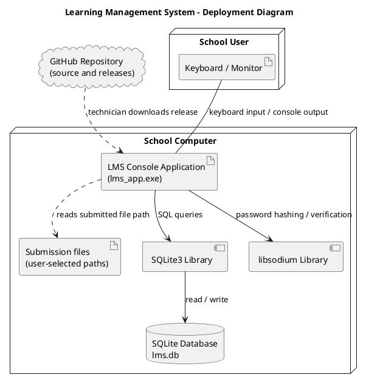

# UML Deployment Diagram

The LMS is a locally installed C++17 console application. SQLite provides persistent storage on the same computer. The application uses libsodium for password hashing.

## Deployment diagram (PlantUML)

## Deployment notes

- The application, SQLite database and required runtime libraries are installed on the school computer.
- Users interact with the application through its console menus.
- The database is created automatically when the application starts if it does not already exist.
- The default database filename is `lms.db` in the application's current working directory. A different path can be supplied as a command-line argument.
- Submission files are referenced by the path entered by the student. The school should ensure that these files remain accessible to the computer running the LMS.
- GitHub is used to obtain the source/release; it is not required while the local application is running.
